# Task 3: Evaluation, Scaling and Final Analysis

This folder holds Task 3 of the project. It covers handbook items M4 (learning curves), M5 (rating and top-N evaluation, runtime and memory scaling) and M6 (popularity bias, cold start, latent factor interpretation). It also includes the final test-set evaluation.

**Guiding question.** Does a lower reconstruction error on observed ratings necessarily produce better recommendations for unseen items?

**Short answer: no.** The ALS model with the lowest rating error (k = 2, lambda = 1) has the best test RMSE (0.927). But it ranks movies much worse than a model selected for ranking quality (k = 20, lambda = 15). It is even worse than a simple most-popular list (test NDCG@10: 0.047 vs 0.140 vs 0.120).

## Folder layout

| Path | Content |
|---|---|
| `03_evaluation.ipynb` | The whole analysis, Steps 0 to 8. Each step opens with a goal/method cell and closes with a "Step N results" cell. |
| `task3.py` | Shared functions: ALS (copied from `task2`, Task 2), mean baselines and naive SVD (copied from the Task 1 part of the group notebook), top-N ranking metrics. |
| `reports_03/` | The 12 figures produced by the notebook (shown below). |
| `outputs/` | Result tables (`eval_*.csv`) and saved factor matrices (`eval_*.npy`). |

The same Task 3 cells, with their figures, are also appended at the end of the group notebook `../Movie Recommendation by Low-Rank Factorization.ipynb` (section "Task 3: Evaluation, Scaling and Final Analysis"). That copy runs from the repository root and writes to the same `outputs/` and `reports_03/` folders.

Inputs are read, never modified, from the shared folder `../data/processed/`:
- `train.csv`, `validation.csv`, `test.csv` (Task 1 split: 80,031 / 9,987 / 9,982 ratings)
- `U_best.npy`, `V_best.npy`, `als_hyperparameter_tuning.csv`, `als_best_convergence_history.csv` (Task 2 ALS outputs)
- `../data/raw/ml-100k/u.item` (movie titles and genres)

## How to run

From the repository root:

```bash
python3 -m venv .venv
.venv/bin/pip install numpy scipy pandas matplotlib jupyter
```

Then open `task3_evaluation/03_evaluation.ipynb` with the `.venv` kernel and run all cells. The notebook must be run from its own folder, because all paths are relative to it. A full run takes about 1.5 minutes. All results are deterministic (seed 42), except the timings of Step 4, which change by a few percent between runs.

## Output files (`outputs/`)

| File | Step | Content |
|---|---|---|
| `eval_tuning_50iter.csv` | 1 | Grid k x lambda re-run with `max_iter = 50`, with a `Converged` column |
| `eval_U_final.npy`, `eval_V_final.npy` | 1 | Final model for rating accuracy (k = 2, lambda = 1) |
| `eval_test_results.csv` | 2 | Validation and test RMSE / MAE of every model |
| `eval_topn_results.csv` | 3 | Precision, Recall, NDCG at N = 5, 10, 20 on the test set |
| `eval_scaling.csv` | 4 | Time per iteration and peak memory vs k and vs number of ratings |
| `eval_popularity_bias.csv` | 5 | Popularity, head share and catalogue coverage of the top-10 lists |
| `eval_cold_start_buckets.csv` | 6 | Test RMSE grouped by number of train ratings per user and per movie |
| `eval_cold_start_simulation.csv` | 6 | Simulated cold start: RMSE with n = 0, 1, 3, 5, 10 ratings kept |
| `eval_latent_genre_centroids.csv` | 7 | Genre averages on the two latent axes |
| `eval_U_rank.npy`, `eval_V_rank.npy` | 8 | Ranking-selected model (k = 20, lambda = 15) |
| `eval_final_comparison.csv` | 8 | Final table: rating accuracy and ranking quality side by side |

## What was done, step by step

### Step 0. Setup and alignment
We loaded the splits and the Task 2 factors and rebuilt the user and movie index mapping. Then we checked that the split is warm-start (every validation and test user and movie appears in train) and that no rating is in two splits. The Task 2 validation RMSE (0.9265) is reproduced exactly from the saved factors, so the rows of U and V line up with our indices.

### Step 1. Learning curves and tuning (M4)
In the Task 2 grid, 32 of 36 runs stopped at `max_iter = 15` before converging. We re-ran the whole grid with `max_iter = 50`: 25 of 36 runs converge, and the winner is the same (k = 2, lambda = 1, validation RMSE 0.9227 after 23 iterations).

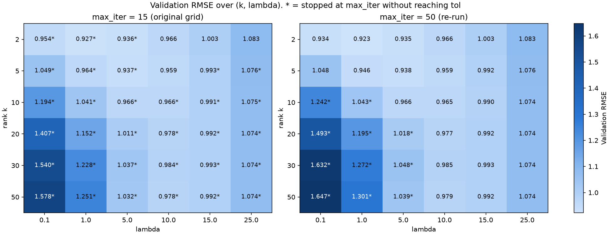

**How to read it.** Each cell is the validation RMSE of one (k, lambda) pair. Light colour means low error, which is good. Left: the original 15-iteration grid. Right: the re-run with 50 iterations, on the same colour scale. A `*` marks runs that stopped at `max_iter` without converging. The best region is a diagonal valley: larger k needs larger lambda. The bottom-left corner (large k, small lambda) is the overfitting region.

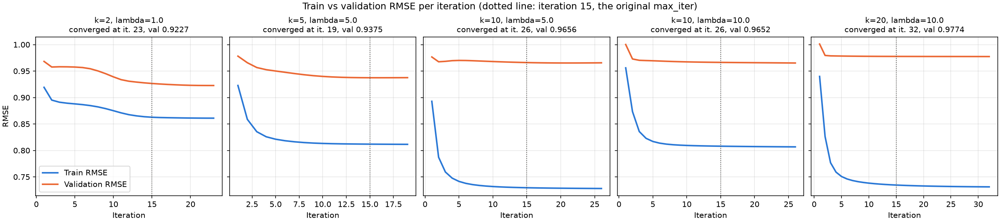

**How to read it.** Train (blue) and validation (orange) RMSE per iteration for five configurations. The dotted line is iteration 15, where the original grid stopped. Train error always decreases. For k >= 10 the validation error flattens early, so the gap between the two curves (overfitting) grows with k.

### Step 2. Rating accuracy on the test set
This is the first and only use of the test set for model choice. All choices were already fixed on validation.

| Model | Test RMSE | Test MAE |
|---|---:|---:|
| Global mean | 1.1331 | 0.9504 |
| User mean | 1.0509 | 0.8400 |
| Item mean | 1.0273 | 0.8179 |
| Naive SVD (k = 10) | 2.5883 | 2.3183 |
| **ALS (k = 2, lambda = 1)** | **0.9270** | **0.7270** |

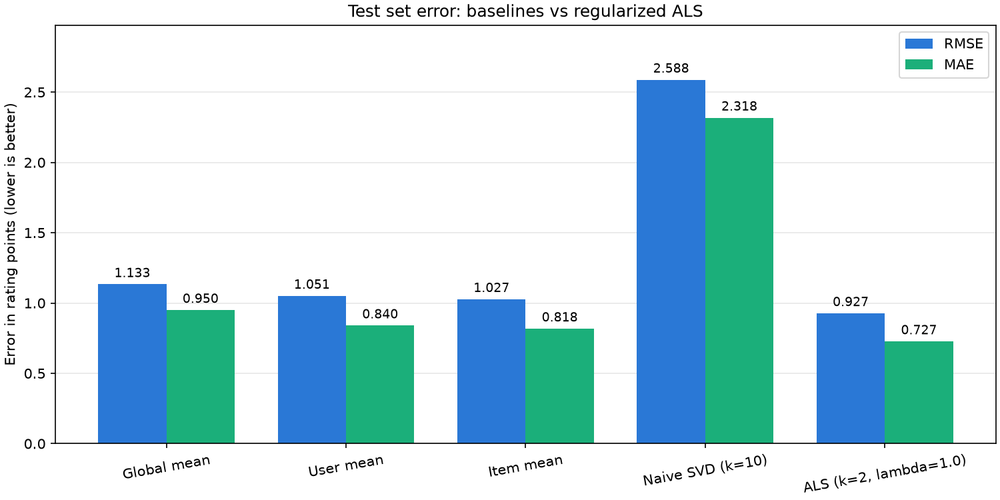

**How to read it.** Lower bars are better. ALS is 9.8% better than the best baseline (item mean). Naive SVD is the worst model, even worse than the global mean. It fills the 95% missing entries with zeros, so it learns to predict "no rating" (average prediction about 1.2 stars against a true average of 3.5).

### Step 3. Top-N ranking (M5)
For each user we score every movie not yet rated in train or validation with S = U V^T and keep the top N. A movie is relevant if the user rated it 4 or 5 in the test set. 869 users are evaluated (74 have no relevant test movie). We compare ALS with most popular, item-mean ranking and random.

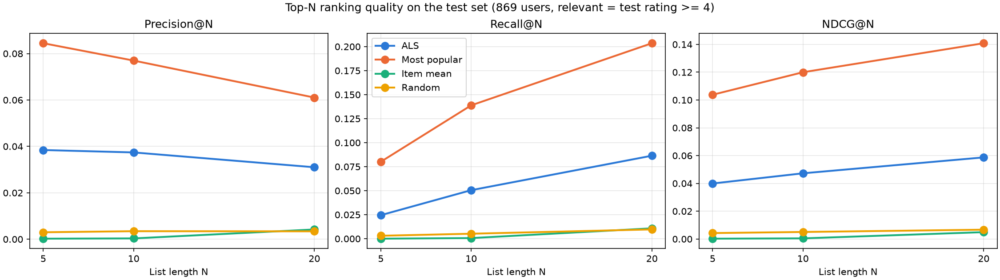

**How to read it.** Precision, Recall and NDCG for list lengths N = 5, 10, 20. Higher is better. The most-popular list (orange) beats ALS k = 2 (blue) by 2 to 3 times on every metric. Item mean (green) is worse than random. Its top movies have a 5.0 average from only one or two ratings.

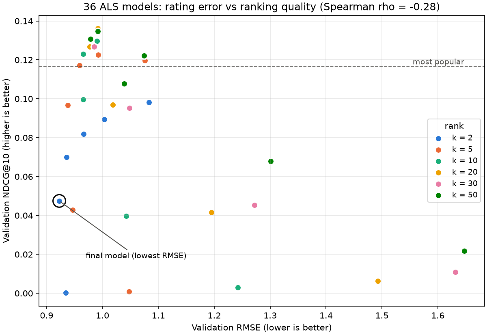

**How to read it.** Each point is one ALS model of the grid, on validation. The x axis is rating error (left is better) and the y axis is ranking quality (up is better). If a low RMSE gave a good ranking, the points would go from top-left to bottom-right. They do not (Spearman -0.28, not significant). The circled model has the lowest RMSE but a low NDCG. Only models with large lambda rise above the dashed most-popular line.

### Step 4. Runtime and memory scaling (M5)
Theory: one ALS iteration costs O(|Omega| k^2 + (m + n) k^3) time and O((m + n) k + |Omega|) memory. We measured time per iteration and peak memory for k from 2 to 200 and for 25% to 100% of the training ratings, and fitted a cost model to the measurements.

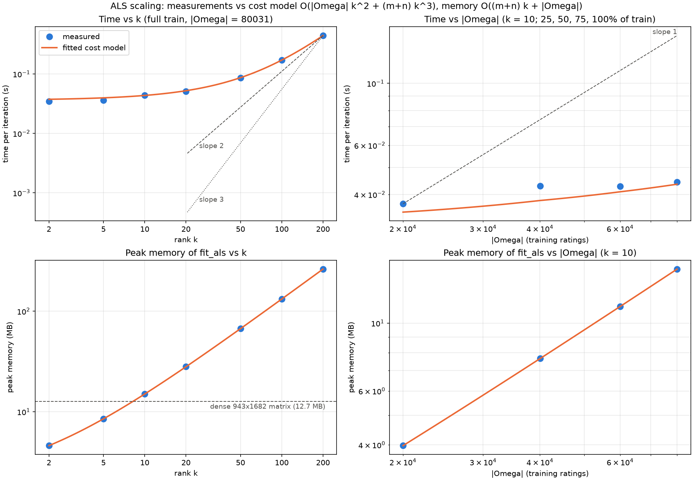

**How to read it.** Log-log plots: blue points are measurements, the orange line is the fitted cost model, and grey lines are reference slopes. Time grows much more slowly than k^2 or k^3. At this scale most of the time is a fixed Python cost per user or movie row (about 14 microseconds per row, 96% of the time at k = 2). The k^2 term becomes visible only for large k (about 60% at k = 200). Memory is linear in k and in |Omega|. The dense 943 x 1682 matrix (12.7 MB, dashed line) is never built.

### Step 5. Popularity bias (M6)
We measured how much each recommender concentrates on popular movies, using the top-10 lists for all 943 users. No test labels are used in this step.

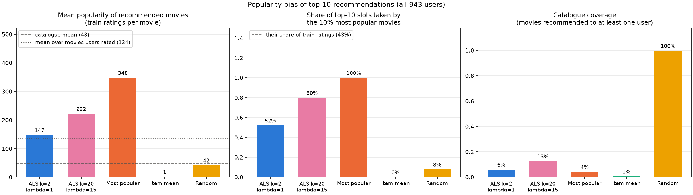

**How to read it.** Left: average popularity of the recommended movies, against the catalogue average (47.6 ratings) and against the movies users actually rated (134.5). Middle: share of recommendation slots taken by the 10% most popular movies, which receive 42.6% of all ratings. Right: catalogue coverage. Both ALS models recommend more popular movies than users actually watch (52% and 80% head share), and each covers at most 13% of the catalogue.

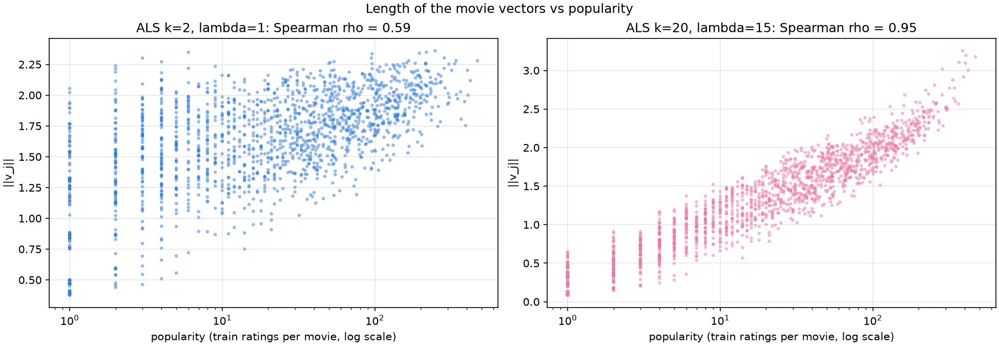

**How to read it.** Each point is a movie. The x axis is its number of train ratings (log scale) and the y axis is the length of its factor vector. With lambda = 15 (right) the length follows popularity almost perfectly (Spearman 0.95, against 0.59 for lambda = 1). Rarely rated movies get short vectors and can never reach the top of a list. Strong regularization therefore acts as a popularity prior, which is why the lambda = 15 model ranks better offline.

### Step 6. Cold start (M6)

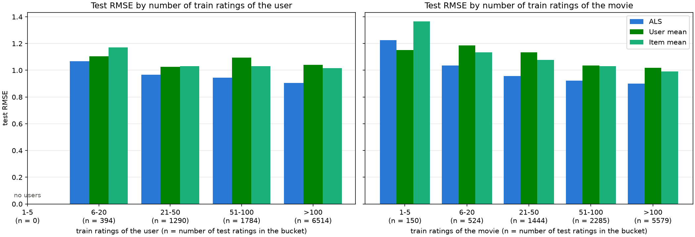

**How to read it.** Test RMSE grouped by how many train ratings the user (left) or the movie (right) has. ALS (blue) improves steadily with more data (from 1.07 to 0.90). The only bucket where it loses is movies with 1 to 5 ratings, where the user mean is better. No user has 5 or fewer ratings, because MovieLens keeps only users with at least 20.

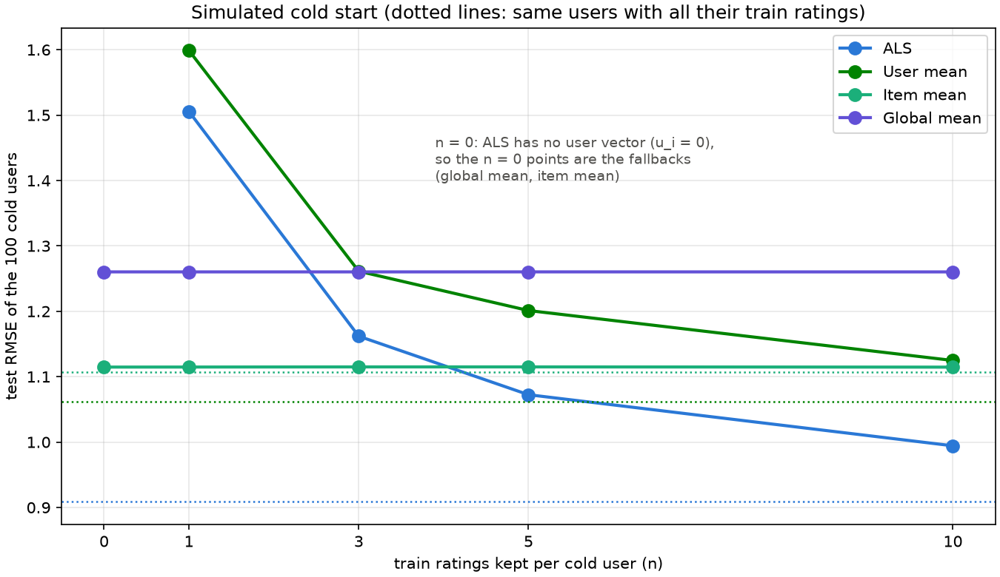

**How to read it.** We took 100 users and kept only n of their train ratings, refitted ALS and measured their test RMSE. Dotted lines show the same users with all their ratings. With n = 0, ALS cannot predict (its user vector is zero), so the points are the fallbacks (item mean or global mean). With one rating ALS is worse than the fallback. It needs about 5 ratings to beat the item mean.

### Step 7. Latent factor interpretation (M6)
The factors are only defined up to a rotation: U V^T = (U Q)(V Q)^T for any orthogonal Q. So the raw axes have no meaning on their own. We used two rotation-independent axes instead: the direction of the average user and the direction orthogonal to it.

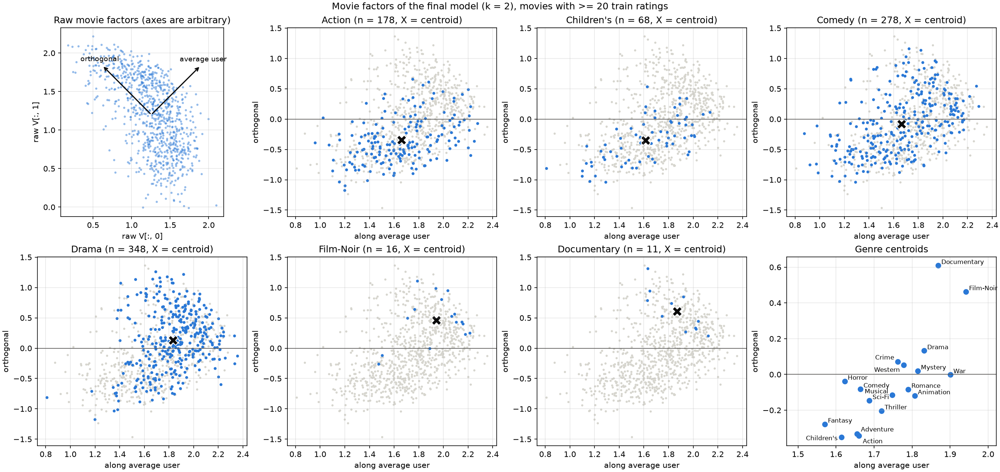

**How to read it.** Top-left: raw movie vectors, with the two new axes drawn as arrows. The other panels show the movies in the new coordinates, one genre highlighted at a time (X = genre centroid), and finally all genre centroids.

- **Axis 1 (horizontal) = how much a movie is liked, by people in general.** It correlates 0.915 with the movie's mean rating. Movies everyone likes are on the right (Schindler's List, Casablanca), movies almost nobody likes on the left (McHale's Navy). This part of a prediction is the same for every user.
- **Axis 2 (vertical) = who likes it.** Below zero are movies liked mostly by fans of mainstream blockbusters (Twister, Independence Day). Above zero are movies liked mostly by fans of art-house cinema (Crumb, Three Colors: Blue, A Clockwork Orange). Twister (mean 3.21) and Lost Highway (mean 3.12) are liked about equally on average, so they are close on axis 1, but they sit at opposite ends of axis 2 because different people like them. Users lie on the same axis: when a user and a movie are on the same side, the predicted rating goes up, and when they are on opposite sides it goes down. With k = 2 this is the only direction that personalizes the recommendations.

Every prediction splits into one term per axis: $\hat r_{ij} = (u_i^\top d_1)(v_j^\top d_1) + (u_i^\top d_2)(v_j^\top d_2)$, that is "how generous the user is" times "how good the movie is", plus the taste match.

**Genres were not used to build the map.** Each movie's position is learned only from the ratings. The genre labels from `u.item` were added afterwards to interpret it, and a genre centroid is simply the average position of that genre's movies. Genres differ along both axes:

| Genre | Axis 1 (how liked) | Axis 2 (by whom) |
|---|---:|---:|
| Fantasy | 1.57 | -0.28 |
| Children's | 1.61 | -0.35 |
| Action | 1.66 | -0.34 |
| Drama | 1.83 | +0.13 |
| Documentary | 1.87 | +0.61 |
| War | 1.90 | -0.00 |
| Film-Noir | 1.94 | +0.46 |

On axis 1 Film-Noir, War and Documentary are rated somewhat better on average than Fantasy or Children's. The clearest separation, though, is on axis 2, where the blockbuster genres sit below zero and the art-house genres above. The two axes are therefore not perfectly "pure". Axis 1 captures the strongest pattern in the ratings (overall appeal) and axis 2 the strongest remaining one, which lines up with mainstream vs art-house. Art-house movies are also rated slightly better on average, which is why axis 2 still has a weak correlation (0.34) with mean rating, while it is almost unrelated to popularity (-0.09). Within each genre the spread is large (Comedy and Drama cover almost the whole map), so a genre tells you only where its movies sit on average.

**Caveat.** The factors are defined only up to a rotation, so these axes are a choice made to make the map readable (the average-user direction and the one orthogonal to it). The model itself only contains the positions of users and movies, not the axes.

### Step 8. Final comparison and answer

The model selected by validation NDCG@10 (k = 20, lambda = 15) was evaluated on the test set once, like the RMSE-selected one.

| Model | Selected by | Test RMSE | NDCG@10 |
|---|---|---:|---:|
| ALS k = 2, lambda = 1 | validation RMSE | **0.927** | 0.047 |
| ALS k = 20, lambda = 15 | validation NDCG@10 | 0.988 | **0.140** |
| Most popular | baseline | n/a | 0.120 |

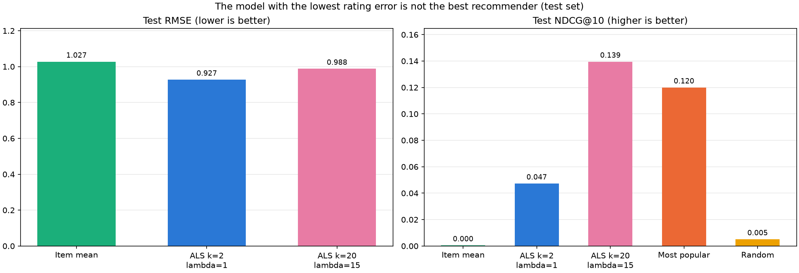

**How to read it.** Left: rating error (lower is better). Right: ranking quality (higher is better). The model that wins on the left loses on the right. A paired bootstrap over the 869 users confirms that the gaps are real. The k = 20 model beats k = 2 by +0.092 NDCG@10 (95% CI [+0.081, +0.104]) and most popular by +0.020 (95% CI [+0.006, +0.034]).

**Conclusion.** A lower reconstruction error does not necessarily give better recommendations. The two goals diverge because:
1. RMSE is measured only on the ratings users chose to give, while ranking is done over all unseen movies.
2. The main signal behind a low RMSE (general appeal) is the same for every user and does not personalize.
3. Strong regularization pushes rarely rated movies down, which helps ranking but costs RMSE.

Hyperparameters should be chosen with the metric of the real task. Popularity and coverage should be reported next to accuracy. Users with fewer than about 5 ratings need a fallback.

**Limits.** One split and one seed, warm-start users and movies, and a plain ALS model without bias terms. Offline NDCG partly rewards popularity, so a live test would be needed to confirm the gain for real users.
